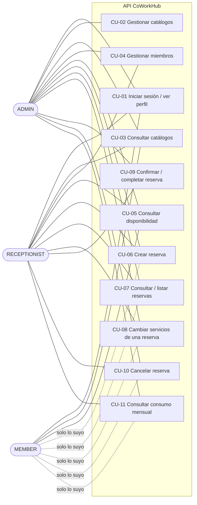
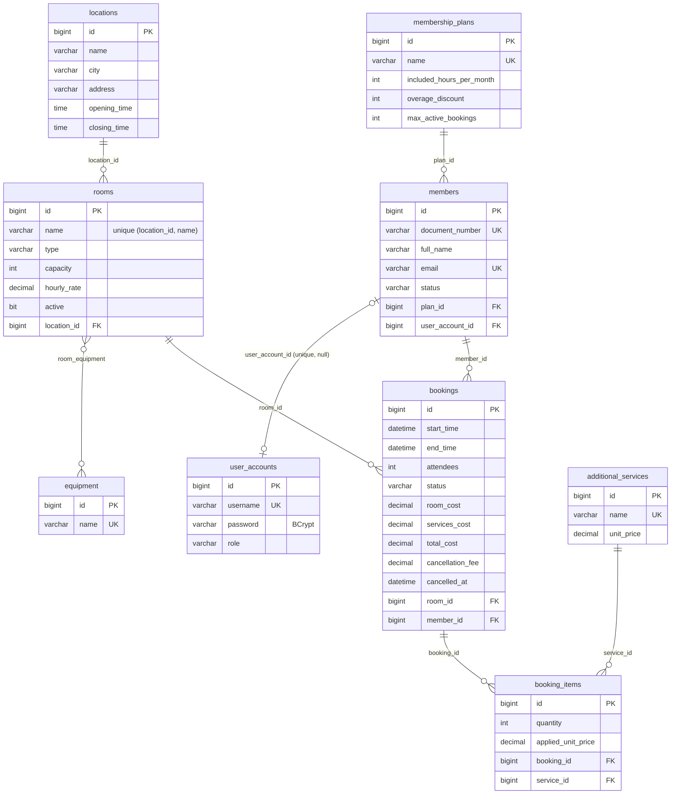

# CoWorkHub — Análisis

## 1. Actores y casos de uso

| Actor | Descripción |
|---|---|
| `ADMIN` | Empleado administrador. Hace todo y es el único que crea, modifica o elimina catálogos. |
| `RECEPTIONIST` | Empleado de recepción. Gestiona miembros y todas las reservas; consulta catálogos. |
| `MEMBER` | Cliente con plan. Consulta catálogos y disponibilidad; opera **solo** sus reservas y su consumo. |

| Caso de uso | Descripción breve |
|---|---|
| CU-01 | El usuario envía usuario y contraseña, recibe un JWT de 60 min y puede consultar su perfil (usuario, rol, `miembroId`). |
| CU-02 | El ADMIN crea, actualiza y elimina sedes, salas (con equipamiento), equipamiento, servicios y planes, respetando unicidad (RN-11) y uso (RN-12). |
| CU-03 | Cualquier usuario autenticado lista y consulta los catálogos. |
| CU-04 | ADMIN/RECEPTIONIST registran un miembro con su cuenta, lo listan con filtros, lo actualizan, suspenden, reactivan o eliminan. |
| CU-05 | Se consultan las salas libres de una sede en una fecha y rango horario, con capacidad mínima y equipamiento opcionales. |
| CU-06 | Se crea una reserva con servicios; el sistema valida RN-01 a RN-06 y calcula el costo (RN-07). |
| CU-07 | Se consulta una reserva o se listan por miembro, por sala y fecha, o por estado. |
| CU-08 | Mientras la reserva está `PENDING` se agregan o quitan servicios y se recalcula el costo (RN-10). |
| CU-09 | El personal confirma (`PENDING → CONFIRMED`) o completa (`CONFIRMED → COMPLETED`) una reserva (RN-09). |
| CU-10 | Se cancela una reserva aplicando la política de cargos (RN-08). |
| CU-11 | Se consultan las horas incluidas, usadas, restantes y excedentes del mes. |

## 2. Glosario

| Término | Definición |
|---|---|
| **Reserva** | Uso de una sala por un miembro en un intervalo `[inicio, fin)` del mismo día, de 30 min a 8 h en múltiplos de 30 min, con servicios adicionales opcionales. Ciclo de vida: `PENDING → CONFIRMED → COMPLETED`, o `PENDING/CONFIRMED → CANCELLED`. |
| **Plan** | Membresía contratada por un miembro: horas incluidas por mes, porcentaje de descuento sobre las horas excedentes y máximo de reservas activas futuras. |
| **Horas incluidas** | Horas de sala por mes calendario que el plan cubre sin costo. Se consumen por las reservas `PENDING`, `CONFIRMED` y `COMPLETED` cuyo inicio cae en ese mes, y por las canceladas tarde. |
| **Horas excedentes** | Horas que superan las incluidas del mes; se cobran a `hourlyRate × (1 − overageDiscount/100)`. |
| **Solapamiento** | Dos reservas activas (`PENDING`/`CONFIRMED`) de la misma sala se solapan si `inicioA < finB` y `finA > inicioB`. Si una termina exactamente cuando empieza la otra, **no** se solapan. |
| **Cargo por cancelación** | Monto cobrado al cancelar: 0 con ≥ 24 h de anticipación; 50 % del costo de sala con < 24 h y ≥ 2 h; con < 2 h o ya iniciada no se puede cancelar. |

## 3. Modelo entidad-relación

### Justificación de cada relación

| Relación | Lado dueño | `fetch` | `cascade` / `orphanRemoval` | Por qué |
|---|---|---|---|---|
| `Location 1 → N Room` | `Room.location` (FK `location_id`) | `@ManyToOne LAZY`; `Location.rooms` `LAZY` (`mappedBy`) | Ninguno | La FK vive en el lado N. La sede y sus salas tienen ciclos de vida independientes: borrar una sede con salas está prohibido (RN-12), así que no se propaga nada. |
| `Room N ↔ N Equipment` | `Room.equipment` (`@JoinTable room_equipment`) | `LAZY` | Ninguno | La sala es quien "tiene" equipamiento y se edita desde la sala. El equipamiento es un catálogo: no debe crearse ni borrarse al guardar una sala. Unidireccional para no exponer salas desde el equipamiento. |
| `MembershipPlan 1 → N Member` | `Member.plan` (FK `plan_id`) | `@ManyToOne LAZY`; `MembershipPlan.members` `LAZY` | Ninguno | Un plan no se borra si tiene miembros (RN-12). |
| `Member 0..1 ↔ 0..1 UserAccount` | `Member.userAccount` (FK `user_account_id`, única y nullable) | `LAZY` en el dueño; inverso `mappedBy` | `PERSIST`, `REMOVE` + `orphanRemoval` | La cuenta pertenece al miembro: se crea con él (`POST /api/miembros`) y se borra con él. La FK en `members` permite miembros sin cuenta y cuentas de empleados sin miembro. Los listados de miembros (frecuentes) traen la cuenta con un `EntityGraph`; el lado inverso solo se recorre al iniciar sesión. |
| `Member 1 → N Booking` | `Booking.member` | `@ManyToOne LAZY` | Ninguno | Unidireccional: las reservas se consultan por repositorio, no navegando desde el miembro. |
| `Room 1 → N Booking` | `Booking.room` | `@ManyToOne LAZY` | Ninguno | Igual que la anterior. Además la fila de la sala se bloquea (`PESSIMISTIC_WRITE`) al reservar (RN-01). |
| `Booking 1 → N BookingItem` | `BookingItem.booking` | `@OneToMany LAZY` (`mappedBy`) | `ALL` + `orphanRemoval` | Composición: los detalles no existen sin la reserva. Quitar un servicio de la lista borra la fila (`DELETE /api/reservas/{id}/servicios/{servicioId}`). |
| `AdditionalService 1 → N BookingItem` | `BookingItem.service` | `@ManyToOne LAZY` | Ninguno | El servicio es catálogo; `appliedUnitPrice` congela el precio al agregarlo (RN-07). |

**N+1 y JSON:** todas las colecciones son `LAZY`, `open-in-view` está desactivado y los listados usan
`@EntityGraph` (una sola consulta, verificado con `SHOW_SQL=true`). Los controladores devuelven
DTO `record`, nunca entidades, así que no hay referencias circulares ni `LazyInitializationException`.

## 4. Matriz de trazabilidad

| RF | Reglas | Endpoints | Implementación |
|---|---|---|---|
| RF-01 Catálogos | RN-11, RN-12, RN-13 | `GET/POST/PUT/DELETE /api/{sedes,salas,equipamientos,servicios-adicionales,planes}` | `*ServiceImpl` de catálogos |
| RF-02 Miembros | RN-11, RN-12, RN-13 | `GET/POST/PUT/DELETE /api/miembros`, `PATCH .../suspender`, `PATCH .../activar` | `MiembroServiceImpl` |
| RF-03 Disponibilidad | RN-01, RN-04 | `GET /api/disponibilidad` | `SalaServiceImpl.disponibles` |
| RF-04 Crear reserva | RN-01 a RN-07, RN-13 | `POST /api/reservas` | `ReservaServiceImpl.crear`, `ReglasReserva`, `CalculadoraCostos` |
| RF-05 Consultar reservas | RN-13 | `GET /api/reservas/{id}`, `GET /api/reservas?miembroId= / ?salaId=&fecha= / ?estado=` | `ReservaServiceImpl.obtener/listar` |
| RF-06 Servicios | RN-07, RN-10, RN-13 | `POST /api/reservas/{id}/servicios`, `DELETE /api/reservas/{id}/servicios/{servicioId}` | `ReservaServiceImpl.agregarServicio/quitarServicio` |
| RF-07 Confirmar | RN-09 | `POST /api/reservas/{id}/confirmar` | `ReservaServiceImpl.confirmar` |
| RF-08 Cancelar | RN-08, RN-09, RN-13 | `POST /api/reservas/{id}/cancelar` | `ReservaServiceImpl.cancelar`, `CalculadoraCostos.cargoCancelacion` |
| RF-09 Completar | RN-09 | `POST /api/reservas/{id}/completar` | `ReservaServiceImpl.completar` |
| RF-10 Consumo | RN-07, RN-08, RN-13 | `GET /api/miembros/{id}/consumo?mes=` | `MiembroServiceImpl.consumo`, `ContadorHoras` |
| RF-11 Login JWT | — | `POST /auth/login` | `AutenticacionServiceImpl`, `JwtService` |
| RF-12 JWT y permisos | RN-13 | Todos los no públicos | `JwtAuthenticationFilter`, `SecurityConfig`, `@PreAuthorize`, `AutorizacionRecursos` |
| RF-13 Swagger | — | `/doc/swagger-ui.html`, `/v3/api-docs` | `OpenApiConfig` |
| RF-14 Perfil | — | `GET /auth/perfil` | `AuthController.perfil` |
| RF-15 Salud | — | `GET /actuator/health` | Spring Boot Actuator |

## 5. Supuestos y decisiones

1. **Horas al cancelar tarde.** Si se cancela con ≥ 24 h, las horas se devuelven al plan. Si se cancela entre 24 h y 2 h,
   además del cargo del 50 %, **las horas siguen contando como usadas**. Para distinguirlo se agregó el atributo
   `Booking.cancelledAt`.
2. **Mes de las horas.** Una reserva consume horas del mes en que empieza (siempre empieza y termina el mismo día).
3. **Costo calculado una sola vez.** `roomCost` se calcula al crear la reserva con las horas ya consumidas en el mes.
   Si después otra reserva se cancela y devuelve horas, no se recalculan las reservas existentes.
4. **Límites exactos de RN-08.** Exactamente 24 h → sin cargo; exactamente 2 h → 50 %. El límite pertenece al tramo
   más favorable al miembro.
5. **Anticipación de RN-03.** Exactamente 1 h de anticipación se acepta.
6. **Fin de jornada.** La reserva debe terminar a más tardar a la hora de cierre de la sede (fin ≤ cierre) y el
   mismo día; una reserva que termina a las 00:00 del día siguiente cruza la medianoche y se rechaza (RN-02).
7. **Servicio repetido.** Si se agrega un servicio que ya está en la reserva, se suma la cantidad al detalle existente
   y se conserva el precio aplicado original.
8. **Concurrencia (RN-01).** La creación bloquea la fila de la sala con `SELECT … FOR UPDATE` como primera sentencia
   de la transacción (`READ_COMMITTED`). Las solicitudes simultáneas a la misma sala se serializan y la segunda ve
   la reserva de la primera. Las de salas distintas no se bloquean entre sí.
9. **RN-12 para salas y miembros.** Se bloquea la eliminación con cualquier reserva asociada (pasada o futura), para
   conservar el historial.
10. **Unicidad de email** sin distinguir mayúsculas: se guarda en minúsculas.
11. **Listado de reservas sin filtros:** el personal recibe todas; un `MEMBER` debe indicar su propio `miembroId`
    (de lo contrario `403`). Si se envían varios filtros, la prioridad es miembro → sala+fecha → estado.
12. **Reserva inexistente consultada por un MEMBER:** responde `404` (no hay datos ajenos que proteger).
13. **Hora del sistema:** se usa un `Clock` inyectado en la zona del servidor (configurable con `APP_ZONA`); los
    `timestamp` de los errores van en UTC.
14. **Disponibilidad fuera del horario de la sede:** devuelve una lista vacía.

## 6. Fuera de alcance

- Pagos, facturación y medios de pago (el sistema calcula montos, no cobra).
- Interfaz gráfica (se usa Swagger UI, Postman o `curl`).
- Notificaciones (email/SMS), recordatorios y reservas recurrentes.
- Paso automático a `COMPLETED` cuando termina la reserva (se hace con `POST /completar`).
- Refresh tokens, revocación de tokens, cambio o recuperación de contraseña.
- Gestión de cuentas de empleados por API (se cargan en `import.sql`).
- Recalcular reservas existentes cuando se devuelven horas o cambia un plan.
